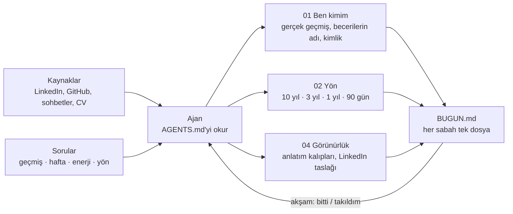

# Career Navigator

Life Navigator düzeninin **Kariyer** alanı: **kimlik + iş + yön.**

**Kendini bir ürün gibi ele al: kimsin, ne yapıyorsun, mesleki olarak nereye gidiyorsun.** Bir AI ajanıyla (Claude Code, Codex ya da `AGENTS.md` okuyan herhangi bir ajan) çalışan, dürüst bir yön bulma yöntemi.



## Budur, bu değildir

| Budur | Bu değildir |
|---|---|
| Kimlik, beceriler, pozisyon | Hayat koçluğu |
| Kendini anlatma, görünürlük | Aile, ilişki, sağlık, kişisel finans |
| Mesleki yön: 10 yıl / 3 yıl / 1 yıl / 90 gün | Terapi ya da motivasyon |
| Öğrenme: terimler, dil | Profilini şişirmek |

Fark: bir Life Navigator hayatın tamamını yönetir (orkestratör); Career Navigator onun tek bir alanıdır: mesleki kimlik, iş ve yön. Hayat yalnız 10 yıllık pusulada bir hayal olarak geçer, başka yerde değil.

## Nasıl kullanılır

1. Boş bir klasör aç; `AGENTS.md` ve `CLAUDE.md` dosyalarını içine kopyala.
2. Ajanı o klasörde başlat; ne istediğini kendi cümlelerinle, dağınık da olsa anlat.
3. Ajan önce ne anladığını söyler, sonra kaynaklarını ister (LinkedIn, GitHub, sohbet geçmişleri), sonra sorular sorar, sonra klasörü kurar.
4. Her sabah tek dosya okursun: `BUGUN.md`. Akşam "bitti" dersin.

## İlkeler

- Yalan yok, şişirme yok: *yaptım / yapıyorum / yapmak istiyorum* ayrımı.
- Önce plan, açık "yap" ile eylem. Ajan profil düzenlemez, mesaj göndermez, para harcamaz.
- Kişinin katkısı AI'ınkinden ayrılır.
- Önce diyagram, sonra yazı.
- Günde tek küçük iş; kaçırılan gün atlanır.

## Klasör yapısı

```
00-baslangic/     0.1, 0.2 ... (yeniden yazılmaz, eklenir)   01-ben-kimim/     geçmiş · beceriler · haftam · kimlik
02-yon-ve-plan/   10 yıl · 3 yıl · 1 yıl · 90 gün            03-ornekler/      kişiler · şirketler · çerçeveler
04-gorunurluk/    anlatım · LinkedIn · toplantılar           05-sozluk/        terimler · roller
overview.md · HARITA.md · TAKVIM.md · BUGUN.md · gunluk.md · YAPILACAKLAR.md
```

## Köken

Bu yöntem, bir kurucu ortağın "ne yaptığımı anlatamıyorum" sorusundan doğdu ve bir gecede Claude ile birlikte kuruldu. Kişisel veri içermez; yalnız yöntemi paylaşır.

MIT lisansı.
