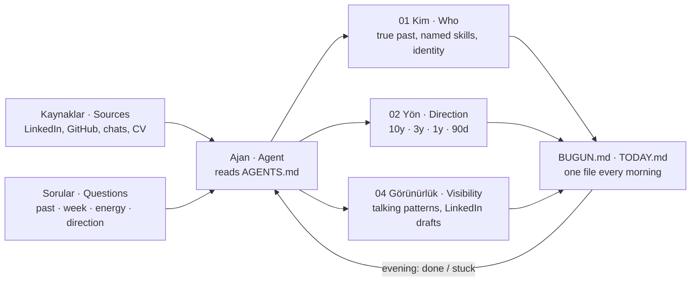

# Career Navigator

Life Navigator düzeninin **Career** (kariyer) alanı: kimlik + iş + yön. · The **Career** area of a Life Navigator setup: identity + work + direction.

**Kendini bir ürün gibi ele al: kimsin, ne yapıyorsun, mesleki olarak nereye gidiyorsun.** Bir AI ajanıyla (Claude Code, Codex ya da AGENTS.md okuyan herhangi bir ajan) çalışan, dürüst bir yön bulma yöntemi.

**Treat yourself like a product: who you are, what you do, where you're going professionally.** An honest wayfinding method you run with an AI agent (Claude Code, Codex, or any agent that reads AGENTS.md).



## Bu nedir, bu değildir · This is / this is not

| Budur · This is | Bu değildir · This is not |
|---|---|
| Kimlik, beceriler, pozisyon · identity, skills, position | Hayat koçluğu · life coaching |
| Kendini anlatma, görünürlük · how you explain yourself, visibility | Aile, ilişki, sağlık, kişisel finans · family, relationships, health, personal finance |
| Mesleki yön: 10 yıl / 3 yıl / 1 yıl / 90 gün · professional direction | Terapi ya da motivasyon · therapy or motivation |
| Öğrenme: terimler, dil · learning: terms, language | Profilini şişirmek · inflating your profile |

Fark · The difference: bir "Life Navigator" hayatının tamamını planlar; Career Navigator yalnız mesleki kimliğini ve yönünü netleştirir. Hayat yalnız 10 yıllık pusulada bir hayal olarak geçer, başka yerde değil. · A life navigator orchestrates your whole life; this one is a single area of it: professional identity, work and direction. Life appears once, as the dream in the 10-year compass, and nowhere else.

## Nasıl kullanılır · How to use

1. Boş bir klasör aç; `AGENTS.md` (ve Claude Code için `CLAUDE.md`) dosyalarını içine kopyala. · Create an empty folder; copy `AGENTS.md` (and `CLAUDE.md` for Claude Code) into it.
2. Ajanı o klasörde başlat ve ne istediğini kendi cümlelerinle, dağınık da olsa anlat. · Start your agent in that folder and tell it what you want, in your own words, messy is fine.
3. Ajan önce ne anladığını söyler, sonra kaynaklarını ister (LinkedIn, GitHub, sohbet geçmişleri), sonra sorular sorar, sonra klasörü kurar. · The agent restates, asks for your sources, asks questions in batches, then builds the folder.
4. Her sabah tek dosya okursun: `BUGUN.md` / `TODAY.md`. Akşam "bitti" dersin. · Every morning you read one file. In the evening you say "done".

Türkçe talimat · Turkish instructions: [`AGENTS.tr.md`](AGENTS.tr.md). Ajanlar her iki dosyayı da okuyabilir; kullanıcının dilinde çalışırlar. · Agents can read either file; they work in the user's language.

## İlkeler · Principles

- Yalan yok, şişirme yok: *yaptım / yapıyorum / yapmak istiyorum* ayrımı. · No lies, no inflation: *did / doing / want to do*.
- Önce plan, açık "yap" ile eylem. Ajan profil düzenlemez, mesaj göndermez, para harcamaz. · Plan first, act on explicit go. The agent never edits profiles, sends messages or spends money.
- Kişinin katkısı AI'ınkinden ayrılır. · The person's contribution is separated from the AI's.
- Önce diyagram, sonra yazı. · Diagram first, then prose.
- Günde tek küçük iş; kaçırılan gün atlanır. · One small thing a day; a missed day is skipped.

## Klasör yapısı · Folder layout

```
00-start/        0.1, 0.2 ... (never rewritten)      01-who-i-am/      past · skills · week · identity
02-direction/    10y · 3y · 1y · 90d                 03-examples/      people · companies · frameworks
04-visibility/   talking · LinkedIn · meetings       05-glossary/      terms · roles
overview.md · MAP.md · CALENDAR.md · TODAY.md · log.md · TODO.md
```

## Köken · Origin

Bu yöntem, bir kurucu ortağın "ne yaptığımı anlatamıyorum" sorusundan doğdu ve bir gecede Claude ile birlikte kuruldu. Kişisel veri içermez; yalnız yöntemi paylaşır. · This method came out of a co-founder's "I can't explain what I do" and was built in one evening with Claude. It contains no personal data; only the method.

MIT lisansı · MIT license.
